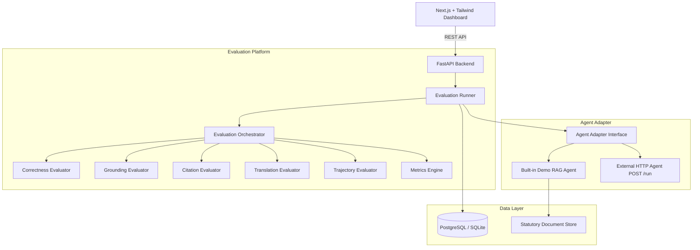

# AgentTrust

### Multilingual AI Reliability Evaluator
> **Evidence-backed reliability reports for AI agents.**

[](backend/tests)
[](backend)
[](frontend)
[](backend)
[](LICENSE)

---

## 1. Overview

**AgentTrust** is a standalone, independent evaluation layer for AI agents. Instead of treating evaluation as a black-box that emits an arbitrary score, AgentTrust evaluates an AI agent's observable execution and generates detailed, evidence-backed diagnostic reports showing whether the agent's answers are reliable.

---

## 2. The Core Problem

Modern AI agents can sound persuasive while:
- Getting facts, dates, and statutory sections wrong.
- Inventing unsupported claims not found in any retrieved knowledge.
- Citing non-existent legal or regulatory articles.
- Contradicting their own retrieved evidence.
- Distorting meaning during multilingual translation (e.g. English $\to$ Kannada / Hindi / Telugu).
- Repeatedly looping over tool calls or skipping necessary retrieval.

Developers need an automated, repeatable way to diagnose and prevent regressions across model versions.

---

## 3. The AgentTrust Solution

AgentTrust tests agents against structured benchmark test cases and runs a multi-layered evaluation pipeline:

```text
Test Dataset
     ↓
Evaluation Runner
     ↓
Agent Under Test (Demo Agent or External HTTP Agent)
     ↓
Execution Trace + Final Answer
     ↓
Evaluation Engine
 ┌──────────────┬──────────────┬──────────────┬──────────────┬──────────────┐
 ↓              ↓              ↓              ↓              ↓
Correctness    Grounding      Citation       Translation    Trajectory
(Layer A+B)    (Supported/    (Source &      (Back-trans    (Sequence &
                Contradicted)  Section Check) drift check)   Loop detection)
 └──────────────┴──────────────┴──────────────┴──────────────┴──────────────┘
     ↓
Composite Reliability Score (30/30/15/15/10) + Rule-Based Severity
     ↓
Interactive SaaS Dashboard + Exportable Reports (HTML, JSON, CSV)
```

---

## 4. Architecture Diagram



---

## 5. Key Features

- **Project Workspaces**: Separate benchmarks across applications, teams, and domains.
- **Agent Registry**: Evaluate the built-in demo agent or connect any external agent via standard HTTP adapter.
- **Structured Test Suites**: Factual requirements, source document references, and potential traps across English, Kannada, Hindi, and Telugu.
- **5 Core Evaluators**:
  1. **Correctness**: Deterministic statutory fact extraction (sections, dates, deadlines, authorities) + semantic meaning check.
  2. **Grounding**: Verification of claims against retrieved documents (`SUPPORTED`, `UNSUPPORTED`, `CONTRADICTED`).
  3. **Citations**: Source existence, section existence, and evidence correspondence (`VALID`, `INVALID_SOURCE`, `INVALID_SECTION`, `MISMATCH`, `MISSING`).
  4. **Translation Fidelity**: Cross-lingual back-translation semantic preservation (`PASS`, `MINOR_DRIFT`, `MAJOR_DRIFT`).
  5. **Trajectory Integrity**: Observable tool sequences, redundant loop detection, and required retrieval verification.
- **Explainable Failure Drill-Down**: Side-by-side diagnostic drawer revealing exact claims, citations, retrieved sources, and failure reasons.
- **Before / After Comparison**: Dynamic diff view between baseline and optimized runs with honest delta calculations.
- **Language Analytics**: Real-time breakdown of reliability metrics across English, Kannada, Hindi, and Telugu.
- **Multi-Format Exports**: 1-click Download JSON, Download CSV, and self-contained HTML report.
- **Zero-Dependency One-Click Demo**: Run immediate comprehensive evaluations without external API keys.

---

## 6. Project Structure

```text
agenttrust/
├── backend/
│   ├── app/
│   │   ├── main.py              # FastAPI app & lifespan initialization
│   │   ├── config.py            # Environment & app configuration
│   │   ├── database.py          # SQLAlchemy async engine & session
│   │   ├── api/                 # REST endpoints (projects, agents, datasets, runs, reports, demo)
│   │   ├── models/              # SQLAlchemy models (Project, Agent, Dataset, TestCase, Run, Trace, Evaluation)
│   │   ├── schemas/             # Pydantic validation schemas
│   │   ├── evaluator/           # 5 Evaluators, Orchestrator, Metrics Engine, Runner
│   │   ├── agents/              # BaseAgentAdapter, DemoAgentAdapter, HTTPAgentAdapter
│   │   ├── services/            # LLM provider, Translation provider, Retrieval store, Report builder
│   │   ├── utils/               # Regex parsing & deterministic fact comparison
│   │   └── seed/                # Seeder for demo project, documents, and test cases
│   ├── tests/                   # Pytest unit and integration test suite (15 passing tests)
│   ├── requirements.txt
│   └── Dockerfile
│
├── frontend/
│   ├── app/                     # Next.js 14 App Router (Overview, Runs, Run Dashboard, Compare, Datasets, Agents)
│   ├── components/              # Navbar, ScoreCard, LanguageBreakdownTable, TestResultsTable, FailureDrilldownModal
│   ├── lib/                     # API client
│   ├── types/                   # TypeScript interfaces
│   ├── package.json
│   └── Dockerfile
│
├── data/
│   ├── demo_documents/          # 4 Statutory civic & environmental compliance policy documents
│   ├── demo_test_cases.json     # 32 structured test cases across EN, KN, HI, TE
│   └── demo_agent_config.json   # Baseline vs optimized simulation configurations
│
├── docs/
│   ├── architecture.md          # Architectural deep-dive & sequence flows
│   ├── evaluation-methodology.md# Evaluator scoring criteria & severity rubrics
│   ├── api.md                   # OpenAPI REST endpoint specifications
│   └── demo.md                  # Demo walkthrough & diagnostic guide
│
├── docker-compose.yml           # Production multi-container setup (postgres, backend, frontend)
├── .env.example
├── README.md
└── LICENSE
```

---

## 7. Quick Start (Running Locally)

### Prerequisites
- Python 3.11+
- Node.js 18+ and npm

### 1. Backend Setup
```bash
cd backend
python3 -m venv venv
source venv/bin/activate
pip install -r requirements.txt

# Run backend API server
uvicorn app.main:app --host 0.0.0.0 --port 8000 --reload
```
The backend initializes the SQLite database automatically.
- API Documentation: [http://localhost:8000/docs](http://localhost:8000/docs)
- Health Check: [http://localhost:8000/health](http://localhost:8000/health)

### 2. Frontend Setup
In a new terminal:
```bash
cd frontend
npm install
npm run dev
```
Open [http://localhost:3000](http://localhost:3000) in your browser.

---

## 8. Running with Docker Compose

```bash
docker compose up --build
```
Services started:
- `frontend`: [http://localhost:3000](http://localhost:3000)
- `backend`: [http://localhost:8000](http://localhost:8000)
- `postgres`: PostgreSQL 16 on port 5432

---

## 9. One-Click Demo Instructions

1. Open [http://localhost:3000](http://localhost:3000).
2. Click **"Run Demo"** in the top navigation or **"Start Demo Evaluation"** on the home page.
3. The platform will automatically:
   - Seed the database with 4 statutory documents and 32 multilingual test cases.
   - Run **Baseline Evaluation** (v1.0.0 with simulated citation errors, translation drift, and wrong facts).
   - Run **Optimized Evaluation** (v2.0.0 with corrected prompt constraints).
   - Redirect to the completed run dashboard.
4. Click on any test case marked `FAIL` to inspect:
   - Claim vs Retrieved Source snippet
   - Citation validity
   - Back-translation drift analysis
   - Chronological observable trace
5. Click **"Compare Run"** to see dynamic Before/After deltas.

---

## 10. Connecting an External AI Agent (HTTP Adapter)

To evaluate your own agent with AgentTrust, expose an HTTP endpoint:

### Expected Request (`POST /api/run`):
```json
{
  "test_case_id": "KN-001",
  "question": "ನಾಗರಿಕ ಸಭೆ ಪರವಾನಗಿ ಪಡೆಯಲು ಕಾರ್ಯಕ್ರಮಕ್ಕೆ ಎಷ್ಟು ದಿನಗಳ ಮುಂಚಿತವಾಗಿ ಅರ್ಜಿ ಸಲ್ಲಿಸಬೇಕು?",
  "language": "kn",
  "category": "correctness",
  "source_documents": [
    { "document_id": "DOC-CP-001", "section_id": "§4" }
  ]
}
```

### Expected Agent Response:
```json
{
  "final_answer": "ನಾಗರಿಕ ಅನುಮತಿಗಳ ನಿರ್ದೇಶನದ §4 ರ ಪ್ರಕಾರ ಕನಿಷ್ಠ 30 ಕ್ಯಾಲೆಂಡರ್ ದಿನಗಳ ಮುಂಚಿತವಾಗಿ ಅರ್ಜಿ ಸಲ್ಲಿಸಬೇಕು.",
  "language": "kn",
  "retrieved_documents": [
    {
      "document_id": "DOC-CP-001",
      "section_id": "§4",
      "content": "Applications must be submitted at least 30 calendar days prior..."
    }
  ],
  "citations": ["DOC-CP-001 §4"],
  "trace": [
    { "step": 1, "event_type": "retrieval", "input_data": {}, "output_data": {} },
    { "step": 2, "event_type": "generation", "input_data": {}, "output_data": {} }
  ],
  "latency_ms": 240
}
```

In the AgentTrust dashboard, navigate to **Agents** $\to$ **Register New Agent**, choose **HTTP Agent**, and enter your endpoint URL.

---

## 11. Running Automated Tests

Run backend tests:
```bash
source backend/venv/bin/activate
PYTHONPATH=backend pytest backend/tests -v
```

Test coverage includes:
- Section, date, deadline, number, and authority regex extraction.
- Citation verification (valid, invalid source, invalid section, mismatch).
- Evidence grounding classification (`SUPPORTED`, `UNSUPPORTED`, `CONTRADICTED`).
- Translation fidelity & drift detection across multilingual datasets.
- Trajectory execution (missing retrieval, redundant loop detection).
- End-to-end evaluation runner and before/after comparison calculations.
- FastAPI REST endpoints.

---

## 12. Evaluation Methodology & Scoring

### Composite Reliability Score Formula
$$\text{Composite Score} = 0.30 \times \text{Correctness} + 0.30 \times \text{Grounding} + 0.15 \times \text{Citation} + 0.15 \times \text{Translation} + 0.10 \times \text{Trajectory}$$
*(For English tests, weights are normalized: Correctness 35%, Grounding 35%, Citation 15%, Trajectory 15%)*

### Failure Severity Rubric
- **CRITICAL**: Contradicted important factual claim in Grounding.
- **HIGH**: Wrong required statutory fact in Correctness or Major Translation Drift.
- **MEDIUM**: Citation mismatch or ungrounded secondary claim.
- **LOW**: Minor trajectory inefficiency or minor translation phrasing drift.

---

## 13. System Boundaries & Scientific Honesty

- **Not Proof of General Trust**: AgentTrust measures selected reliability properties under defined evaluation test cases. It does not certify that an AI model is universally trustworthy.
- **"Unsupported" $\ne$ "Hallucination"**: An unsupported claim means the evaluator found no evidence in the provided evidence set; it does not make universal epistemological claims.
- **No Fabricated Benchmarks**: All scores and deltas displayed in AgentTrust are computed dynamically from actual run execution data.

---

## 14. License

Released under the [MIT License](LICENSE).
